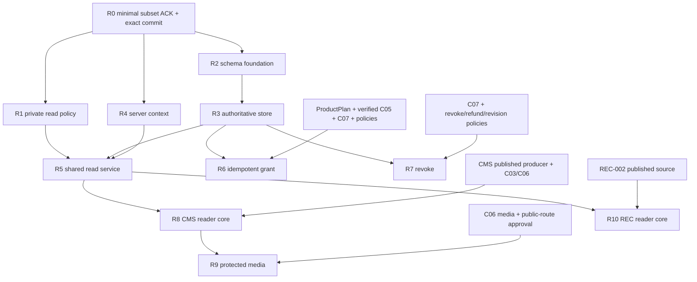

# SUB-004 Runtime — R0 contract draft and implementation slot plan

Ngày: 14/10/2026 (Asia/Saigon). Task hiện tại: `CODEX2B_R0_CONTRACT_DRAFT_AUTHORING`.
Trạng thái: **R0_DRAFT_FOR_REVIEW / ALL_RUNTIME_SLOTS_HOLD**.
Integrator-of-record: ChatGPT / LKC Integrator coordination. Writer R0 được giao: Codex 2B. Independent reviewer: Claude 2B.

## 1. Checkpoint và provenance

| Checkpoint | Exact identity |
|---|---|
| Repository | maivanminhlamkinhmedia-afk/LKC-fintech-demo |
| Provisional local integration base | 1b941b3d855e3d422147ec61dbc25bb2795561c6 |
| Base tree | 99a477edb585c2036136a85cd43ddc46644ca4c2 |
| First parent, PR #27 | bd903b784976eb0a147844cac72fd7295a79c00b |
| Second parent, PR #31 | a0e8e6d7f4b41ba417783e751f6d13daee90992c |
| Common main ancestor | 5e6b14f006453da7f9b1554c210e9ad85a9f8c0c |
| Dedicated draft branch | feature/m2-sub004-r0-contract-draft |
| Draft worktree | E:\LKC-Portal\worktrees\m2-sub004-r0-contract-draft |
| Pure C02 reference, PR #67 | 6b27993cb76f52a307dfdcbf8fd09ab017a14b7a |

PO supplied Claude 2B PASS cho exact integration base/tree; Codex preflight kiểm lại complete-tree union. Integration local-only; #27/#31 vẫn OPEN/DRAFT, unmerged tại preflight 14/10/2026. Base authoring không phê duyệt merge các PR vào main. Runtime proposal/REV1 được review từ nội dung nguyên văn qua conversation; không gán chúng cho unverified local report path. Ba docs này là draft mới, **PENDING_CLAUDE2B_REVIEW**, không tự đóng RT-00..04.

Đọc cùng [C02 v0.2 draft](../contracts/C02-PRODUCT-ACCESS-v0.2.md), [C05 v0.1 draft](../contracts/C05-BILLING-ENTITLEMENT-v0.1.md), [C01 v0.1](../contracts/C01-PRODUCT-CATALOG-v0.1.md), [C02 v0.1](../contracts/C02-PRODUCT-ACCESS-v0.1.md), [roadmap](../ROADMAP.md), [CMS integration](../CMS-INTEGRATION.md), [REC modes](../REC-PRODUCT-MODES-ADDENDUM.md) và [coordination](../COORDINATION.md). Base registry là snapshot lịch sử; semantic ACK hiện hữu theo registry e855d1e được bảo toàn, runtime delta cần ACK riêng.

PR #67 không thuộc integration ancestry chỉ vì được dùng làm reference. Giữ nguyên ba pure source/test files, Product OR, năm Product × ba nhóm, multi-period safety, fail-closed và stopped-sale không tự revoke. Mọi pure decision giữ `runtimeAuthorized: false`, `basis: SUPPLIED_SNAPSHOTS_ONLY`. **Synthetic snapshots, mock clock/store/actor và fixture ALLOW bị cấm dùng làm production authority.** Không thêm caller-controlled flag để nâng pure result thành runtime authorization.

## 2. Minimal R0 subset và owner ACK

R0 do Integrator sở hữu. PO chỉ giao Codex 2B writer cho đúng ba docs hiện tại. Không tự nhận shared runtime/application, schema, Billing, CMS hoặc REC ownership.

Minimal subset đề nghị xét duyệt gồm: stable Product identity/OR/ba nhóm và sale-vs-entitlement separation; trust boundaries actor/store/clock/policy; published version/audience consumption; fail-closed/unresolved behavior; R0-CONS-01..07; C05 verified provenance/idempotent effect; protected serialization/delivery obligations; ownership/dependency gates. Đây là **candidate minimal subset**, chưa APPROVED.

| Owner | ACK runtime delta cần có trên exact revision/subset | Current status |
|---|---|---|
| Product | Product/Plan/benefit references, reader validation, stopped-sale/retirement boundary | PENDING_OWNER_ACK |
| Billing | Verified producer, order effect scope, duplicate/conflict/lost ACK, mutation/audit boundary | PENDING_OWNER_ACK |
| CMS | C03/C06 published version/audience/body/media, safe consumption và cache/delivery | PENDING_OWNER_ACK |
| REC | Same-Product ba nhóm/OR, publish/history, linked content và source/delivery isolation | PENDING_OWNER_ACK |
| Integrator | Exact minimal subset, source/dependency commits, claims, shared-file owners và slot order | PENDING_INTEGRATOR_ACK |
| PO | Relevant policies và riêng từng implementation/activation slot | POLICY_UNRESOLVED / IMPLEMENTATION_HOLD |

ACK cần owner/role, exact document commit/revision, accepted subset, exclusions, OPEN items và evidence provenance. Hiện docs untracked/unstaged, chưa có publication commit: **PENDING_COMMIT**. C01/C02 semantic ACK lịch sử, Linux CI #67 và quyền viết draft không phải runtime ACK. Không yêu cầu toàn bộ commercial policies đóng mới review được R0; phần phụ thuộc policy mở vẫn unresolved. R1 chỉ được triển khai sau minimal subset được ACK trên exact document commit và PO authorization riêng, với relevant policy boundary rõ ràng.

## 3. Dependency inventory

| Dependency | Pinned candidate source hoặc gap | Constraint |
|---|---|---|
| Product persistence, PR #36 | 0bbbd3ef768e3f44a3cb9d061744526316d535d7 | Draft/unmerged; không có nghĩa ProductPlan đã sẵn sàng |
| C01 producer, PR #42 | 6bd8b7222180dce82ed2d13c813606efed94e046 | Draft/unmerged, CMS-staff guarded; không nới Auth/RBAC để gọi từ CLIENT |
| CMS audience schema, PR #53 | 78fc4bdb82e83e9cb3c7fe671a080b1668841026 | Draft/unmerged; không chứng minh reader published |
| CMS W0, PR #55 | 5321f28673eeee11ed8f913c78c7cdcb38896f9e | Draft/unmerged, draft writer; không paid activation |
| CMS queue, PR #56 | 61c5591bb875bffaeb3d71d2f734d39d1e87faf7 | Draft/unmerged, private review queue |
| Pure C02, PR #67 | 6b27993cb76f52a307dfdcbf8fd09ab017a14b7a | Draft/unmerged; source-review/Linux-CI evidence không là runtime proof |
| ProductPlan / immutable order snapshot | PENDING_COMMIT | Product lane/Codex 2A; exact scope và revision cần Product owner ACK |
| Billing/C05 verified producer | PENDING_COMMIT | Billing owner do Integrator chỉ định; không thuộc grant R0 |
| C07 audit integration | PENDING_COMMIT | Integrator/audit owner chốt durable effect semantics |
| CMS published producer, C03/C06 consumer subset | PENDING_COMMIT | CMS owner; W0/queue không thay thế được |
| REC-002 published/version/history reader | PENDING_COMMIT | REC owner; không dựng lại REC-001 |

PR statuses là snapshot preflight, không bảo đảm tương lai. PENDING_COMMIT là gap trong inventory đã khảo sát, không khẳng định mọi local developer đều không có source. Trước từng slot phải pin actual compatible commits, verify merge bases/scopes/claims và target security baseline. Không tự cherry-pick/reference code vào R0 hoặc tự sửa source để giải quyết dependency drift.

## 4. R0–R10 dependency DAG và slot order

Risk B/C dưới đây là planning labels: B cho shared/public integration surface; C cho authority/persistence/financial correctness. Integrator phải xác nhận risk/owner tại grant; không phải slot assignment hiện hữu. Runtime slots đều HOLD.

Mỗi edge chỉ là prerequisite, không cấp quyền thực thi. R2 còn chờ schema slot, ProductPlan/source references và approved policies cần cho physical model; R4 còn chờ actor/context protocol ACK. R6/R7/R5 phải cùng consistency/revision protocol dù có thể phát triển theo branch riêng. Safe runtime activation cần writer readiness; không bật read-only runtime bằng fake seed grants để né R6/R7.

### R0 — Contracts/task draft; Integrator-owned

Risk B/C về semantic scope; writer duy nhất Codex 2B cho grant hiện tại. CREATE đúng:

- `docs/lkc-platform/contracts/C02-PRODUCT-ACCESS-v0.2.md`
- `docs/lkc-platform/contracts/C05-BILLING-ENTITLEMENT-v0.1.md`
- `docs/lkc-platform/tasks/SUB-004-RUNTIME.md`

MODIFY/DELETE 0. Deliver untracked/unstaged fingerprints, independent review, owner ACK. Stage/commit/publication cần grant khác; R0 completion không đồng nghĩa runtime ready.

### R1 — Lane-private read contract/policy; proposed Codex 2B; risk C

Candidate CREATE: `src/features/subscriptions/entitlement-read-contract.ts`, `src/features/subscriptions/entitlement-read-policy.ts`, `tests/subscription-entitlement-read-policy.test.mjs`. MODIFY/DELETE 0.

After approved R0 minimal subset, exact acknowledged doc commit và PO slot grant. Pure logic/supplied facts only; unresolved operations stay unresolved. No shared port, server adapter, DB or synthetic runtime authorization. Import/reference PR #67 phải theo compatible approved dependency base; không sửa ba pure files.

### R2 — Persistence foundation; Integrator-assigned single schema writer; risk B/C

Candidate MODIFY: `prisma/schema.prisma`. Candidate CREATE: `prisma/migrations/20261014000000_subscription_entitlement_foundation/migration.sql`, `tests/subscription-entitlement-schema.test.mjs`. DELETE 0.

After R0, actual ProductPlan/User/source references, C05/C07 requirements, policy/schema decisions và CMS schema-owner handoff. Migration name/date chỉ là candidate, chưa reserved; recheck collision/order tại grant. Không giả định current schema có SubscriptionPeriod/order/revision models. Separate permission cần cho schema authoring, migration application và target DB tests.

### R3 — Authoritative read store; proposed Codex 2B; risk C

Candidate CREATE: `src/features/subscriptions/entitlement-store.ts`, `tests/subscription-entitlement-store.test.mjs`. MODIFY/DELETE 0.

After R2 exact schema/client contract, approved store/clock/locking protocol và compatible target. Adapter implementation không đủ activation; phải có real consistency/constraints/concurrency evidence trên authorized MariaDB target. Không lấy replica chưa chứng minh coherent hoặc mock làm authority.

### R4 — Server actor/context composition; shared owner assigned by Integrator; risk B/C

Candidate CREATE: `src/lib/application/entitlement-context.ts`, `tests/subscription-entitlement-context.test.mjs`. MODIFY/DELETE 0.

Proposed implementer Codex 2B chỉ sau explicit shared slot. After minimal R0 và existing server-auth/User checkpoint được ACK. Resolve fresh actor/server clock/transaction boundary; không đổi Auth/RBAC, C01 staff guard hay pretend transaction-client shape là verified context.

### R5 — Shared C02 contract/application/read service; Integrator-owned shared slot; risk B/C

Candidate CREATE: `src/lib/contracts/product-access.ts`, `src/lib/application/product-access.ts`, `src/features/subscriptions/entitlement-read-service.ts`, `tests/subscription-entitlement-read-service.test.mjs`. MODIFY/DELETE 0.

Proposed writer Codex 2B sau shared slot grant. After R1/R3/R4 exact revisions, Product/Billing/CMS/REC ACK applicable subset và reader/writer consistency contract. Runtime signatures không được duyệt trước chỉ vì candidate filenames có trong plan. Public DTO/privacy mapping cần approval riêng khi policy còn mở.

### R6 — Idempotent grant; proposed Codex 2B + Billing owner; risk C

Candidate CREATE: `src/features/subscriptions/entitlement-grant-service.ts`, `tests/subscription-entitlement-grant-service.test.mjs`. MODIFY/DELETE 0.

After R2/R3, verified Billing/C05 producer, ProductPlan snapshot, C07 và relevant term/renewal policies. Billing owner vẫn sở hữu payment adapter/order facts; không tự tạo callback route. Event dedupe khác business-key effect; prove lost ACK, concurrent grants và audit/revision atomicity.

### R7 — Revoke mutation; proposed Codex 2B + policy/audit owners; risk C

Candidate CREATE: `src/features/subscriptions/entitlement-revoke-service.ts`, `tests/subscription-entitlement-revoke-service.test.mjs`. MODIFY/DELETE 0.

After R2/R3, C07 và PO-approved revoke/refund/effective-time/restoration/in-flight/revision rules. Không dùng stopped-sale để revoke hoặc late success để resurrect. Cùng writer serialization protocol với R6 và R5.

### R8 — CMS published reader core; CMS owner; risk B/C

Candidate CREATE: `src/features/cms/article-published-query.ts`, `src/features/cms/article-reader-query.ts`, `tests/cms-article-reader-query.test.mjs`. MODIFY/DELETE 0.

After R5 + actual CMS published producer/C03/C06 subset. Published version/audience/body coherent; không đọc working Article khi C02 ALLOW. Đây là consumer core proposal, không claim public page/API/RSC routes đã được cấp slot. Exact entrypoint manifest cần CMS owner đề xuất/Integrator duyệt riêng; không tự mở CLIENT vào staff reader/media.

### R9 — CMS protected reader media; CMS/media owner; risk B/C

Candidate CREATE: `src/features/cms/article-reader-media.ts`, `src/app/api/content/articles/[articleId]/versions/[versionId]/media/[assetId]/route.ts`, `tests/cms-reader-media-route.test.mjs`. MODIFY/DELETE 0.

After R8 + C06, private-storage integrity và separate public-route/activation approval. Dynamic segments là literal candidate directories, chưa tồn tại do draft. Kiểm GET/HEAD/conditional/Range nếu support, asset membership và stale links; không thay Article writer/media routes của staff trong slot này.

### R10 — REC published reader core; REC owner; risk B/C

Candidate CREATE: `src/features/recommendations/recommendation-reader-query.ts`, `tests/recommendation-reader-query.test.mjs`. MODIFY/DELETE 0.

After R5 + REC-002 published/version/history source. Giữ Product OR/ba nhóm, publication/source separation; linked CMS article phải check riêng. Public API/RSC entrypoints và additional exports/delivery chưa có exact manifest: **PENDING_OWNER_SCOPE**, không implicit allowlist hoặc quyền tái dựng REC-001.

## 5. Shared ownership và collision recheck

Đặc biệt R4/R5: tại slot grant và ngay trước first write, Integrator/implementer phải kiểm active registry, direct owner claims, tất cả local worktrees/changes/branches, relevant remote refs và tất cả PR states. Không có PR không chứng minh không có local owner. Kiểm exact candidate paths và related application/contracts namespace, planned concurrent deltas, consumer import boundaries, source commits/tree và schema ordering.

Ghi single writer, exact allowlist/base, exclusions, dependency ACK và handoff. Nếu path đã tồn tại, owner khác claim hoặc source drift thì STOP, báo Integrator; không tự đổi CREATE thành MODIFY, rename tránh collision hoặc rewrite semantic. Candidate path bất kỳ R1–R10 chưa phải reservation. Những source/route/schema delta ngoài candidates cần scope review/grant riêng.

## 6. R0-CONS acceptance mapping

| AC | Slot accountable | Required proof; hiện trạng |
|---|---|---|
| R0-CONS-01 | R0/R3/R4/R5 | Approved clock/store/policy/decision-point authority; design only, NOT_RUN |
| R0-CONS-02 | R3/R5/R6/R7 | Coherent periods/revision, missing state và read/write observations; REAL_MARIADB_EVIDENCE_NOT_RUN |
| R0-CONS-03 | R3/R4/R5 + readers | Clock sample sau waits, expiry crossing trước emission; pure plus real delayed-lock tests NOT_RUN |
| R0-CONS-04 | R2/R6/R7/C07 | Durable uniqueness/effect/revision/audit, rollback/lost ACK, absent anchor; real constraints NOT_RUN |
| R0-CONS-05 | R5/R6/R7 + consumers | Approved in-flight/revoke point; two-session controlled interleavings NOT_RUN |
| R0-CONS-06 | R3/R4/R5 | Actor/store/clock/revision failures fail closed; adapter + real fault tests NOT_RUN |
| R0-CONS-07 | R5/R8/R9/R10 + delivery owners | Publication/policy/version/time revalidation, no reusable allow token; HTTP/RSC/cache/media/delivery NOT_RUN |

Same transaction, isolation label, mocked Clock hoặc interface brand không đủ proof. Protocol phải cover primary/replica choice, clock health/precision, transaction timing, lock order, missing-row anchor và concurrent writer rules. Không hứa DB commit atomic với network bytes hoặc thu hồi downloaded/email bytes đã giao hợp lệ.

## 7. Test matrix và delivery inventory

| Case/surface | Expected security property | Evidence class còn cần |
|---|---|---|
| Valid eligible CLIENT, approved active period | Product đúng được đọc published version; CLIENT không có cms:access | Pure + authoritative auth/store + reader integration |
| Anonymous/forged actor/disabled user | Không paid body/asset; no client allow flag | Server auth + HTTP/RSC negatives |
| Wrong Product; malformed/unknown/duplicate/empty audience | Fail closed; OR chỉ trên audience hợp lệ | Pure + C01 reference/consumer negatives |
| Five Products × three groups; multiple Product OR | Không gate riêng tab/source; A không mở B; A/B audience có valid A thì OR | Pure exhaustive matrix + consumer tests |
| Expired/future/revoked period cùng valid period | Xét mọi period, không first-row denial/allow; boundaries theo approved policy | Pure permutations + real delayed read |
| Stopped sale; research source outage | Không tự revoke; authority outage deny, source outage không đổi quyền | Pure + adapter/consumer fault tests |
| Concurrent grant/revoke/renewal; absent revision anchor | Không double effect, torn read hoặc resurrection | Real MariaDB independent connections/barriers |
| Duplicate Billing callback/conflicting payload/lost ACK | Event vs business key; stable outcome/reconcile; no blind regrant | C05 producer + real fault/concurrency tests |
| Historical/version reader; withdrawn/draft/scheduled | Không bypass publication hoặc unresolved history policy | CMS/REC integration + approved history policy |
| Cache stale after logout/account switch/expiry/revoke | No cross-actor payload reuse; time/revision/content binding | Browser + HTTP/CDN/RSC tests |
| HTTP/JSON/API, RSC/Flight/HTML, prefetch | Authorize trước body/props/stream/conditional response | Actual app-router serialization tests |
| Media direct URL/HEAD/Range/304 nếu support | Resource/version/asset checks; no private-path leakage | C06 + route/storage negatives |
| Search/related/OG/sitemap/public Sheets | Approved public metadata only, linked resources independent | Projection/SEO regression |
| RSS/feed nếu tồn tại | Anonymous không paid body; private-feed auth/revoke chưa approved | Inventory + feed negative tests |
| Exports/download jobs nếu paid-enabled | Recheck enqueue/download; stale signed URL không bypass | Worker/storage/recipient tests |
| Email/notifications/push nếu paid-enabled | Recipient/safe preview scope; recheck app-controlled dispatch/retry | Delivery-owner ACK + simulated dispatch tests |
| Digest/batch nếu tồn tại | Check từng recipient/resource; không reuse enqueue ALLOW | Batch + revoke-before-send tests |
| Outbound webhook nếu tồn tại | Không subscription-to-redistribution shortcut; retry revalidation | Recipient/authz/redistribution policy tests |
| Inbound research webhook | Source auth riêng; payload không grant payment/access | Producer/authentication regression |
| Logs/DLQ/test artifacts | Không raw paid content/payment/contact/token leakage | Error/diagnostic review |

Inventory đã khảo sát source #67 có contact-consultation email, public Sheets/Góc nhìn/sitemap và CRM CSV export; chưa xác nhận subscriber digest/RSS/outbound webhook. Không sửa những surfaces này trong R0 hoặc coi chúng đã là paid readers. Future paid surface phải có exact owner/paths/approval. Subscription không tự cấp CRM export scope. External delivery đã gửi không thể hứa revoke; paid redistribution/retention còn policy gate.

Pure tests dùng synthetic/fixed inputs để kiểm deterministic logic; không gọi PASS cho DB/auth/HTTP/cache integration. Real MariaDB evidence cần target version/config/isolation, actual constraints, two sessions, controlled ordering, timeout/deadlock/rollback/retry/lost-ACK observations. Mocks/SQLite/local object shape không thay proof. Hiện mọi real runtime/DB/reader/delivery test ở plan này **NOT_RUN**.

## 8. Business decision register

| Decision | Status | Blocks dependent operation |
|---|---|---|
| Term/calendar/timezone, activation/boundaries | POLICY_UNRESOLVED | Live period derivation/evaluation semantics |
| Renewal/overlap/stacking/proration | POLICY_UNRESOLVED | Renewal grants/concurrent order resolution |
| Grace | POLICY_UNRESOLVED | Post-term permission; không default zero |
| Refund/chargeback/partial adjustment | POLICY_UNRESOLVED | Financial-to-entitlement transition |
| Revoke/effective instant/restoration/in-flight | POLICY_UNRESOLVED | Mutation/reader latency semantics |
| Historical content access | POLICY_UNRESOLVED | Historical paid version delivery |
| Retirement/benefit changes | POLICY_UNRESOLVED | Changes to sold benefits; saleStopped alone no revoke |
| Revision/cache invalidation | POLICY_UNRESOLVED | Live revision protocol/cached authorization |
| Deny precedence/privacy mapping | POLICY_UNRESOLVED | Public DTO/HTTP/existence disclosure mapping |

PO chốt policy theo exact version, operation và effect; fixtures không thành defaults. R1 có thể được xét cho phần pure unresolved handling sau minimal R0 approval, không cần giả thương mại để code chạy. Operation phụ thuộc policy chưa chốt giữ unresolved/deny, không mở paid access bằng fallback.

## 9. Review, CI và activation gates

1. R0: draft content/fingerprints → Claude 2B independent review → owner subset ACK → Integrator sequencing → PO quyết định slot/commit/publication. Hiện chưa có quyền stage/commit/push/PR.
2. Mỗi implementation slot: pinned dependency tree, fresh claims/collision check, exact allowlist và separate PO authorization. Review actual changed source/tests; meaningful focused Node 22/24, scoped ESLint/strict TypeScript và applicable regressions khi slot được cấp. Pure source unchanged không cần giả reviewer chạy lại author gates.
3. CI: phải xét actual workflow triggers và synthetic merge SHA khác PR head. CI của future slots NOT_RUN; không manual dispatch/rerun/cancel hoặc tạo PR từ draft grant. Prior #67 Linux CI PASS chỉ là pure-source evidence, không MariaDB/auth/paid-reader proof.
4. Target evidence: real DB/concurrency, provider/auth/store, reader/HTTP/RSC/cache/media/delivery tests cần separate approved target/test scope. Không chạy migration/DB/staging để làm đẹp report docs.
5. Staging/activation: separate authorization, reviewed deployment/security baseline, policy/owner ACK, audit/observability/rollback và QA-PAID evidence. Không bật real checks/grant/revoke/readers hoặc payment bằng cách đổi runtimeAuthorized trong pure DTO.

Draft local validation chỉ chứng minh exact three CREATE paths, unchanged base/tracked source, empty staged diff, UTF-8/Markdown/cross-references và fingerprints. Không gọi document validation là runtime integration PASS. Integrator quyết định shared sequencing; Claude 2B review không thay PO execution authorization.

**Gate: R0_DRAFT_AUTHORING_GO / STAGE_HOLD / COMMIT_HOLD / PUSH_HOLD / PR_HOLD / CI_DISPATCH_HOLD / C02_RUNTIME_HOLD / DB_HOLD / STAGING_HOLD / PRODUCTION_NO_GO / MERGE_MAIN_HOLD.**
